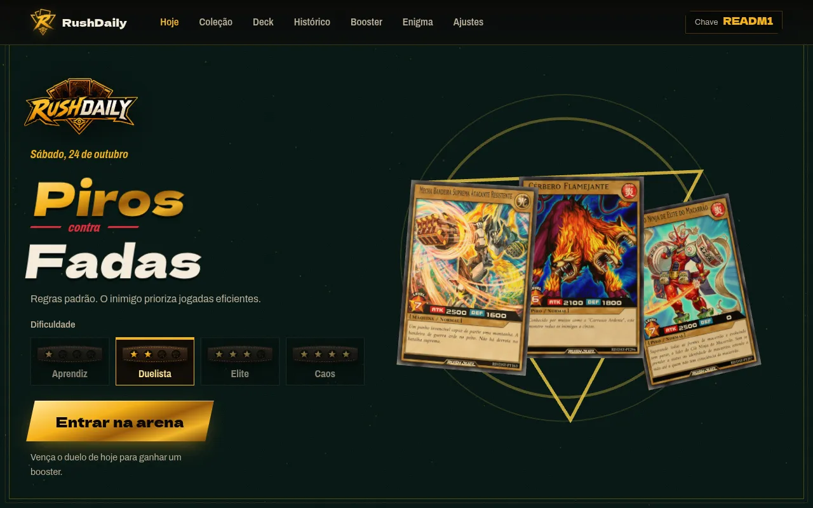
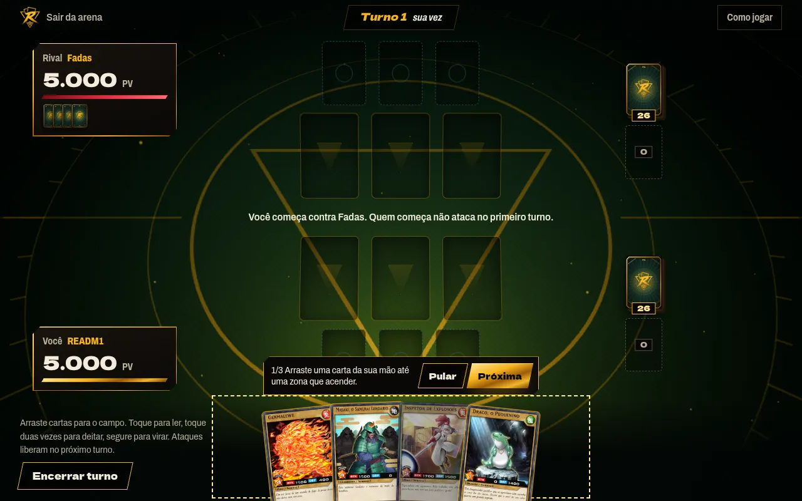
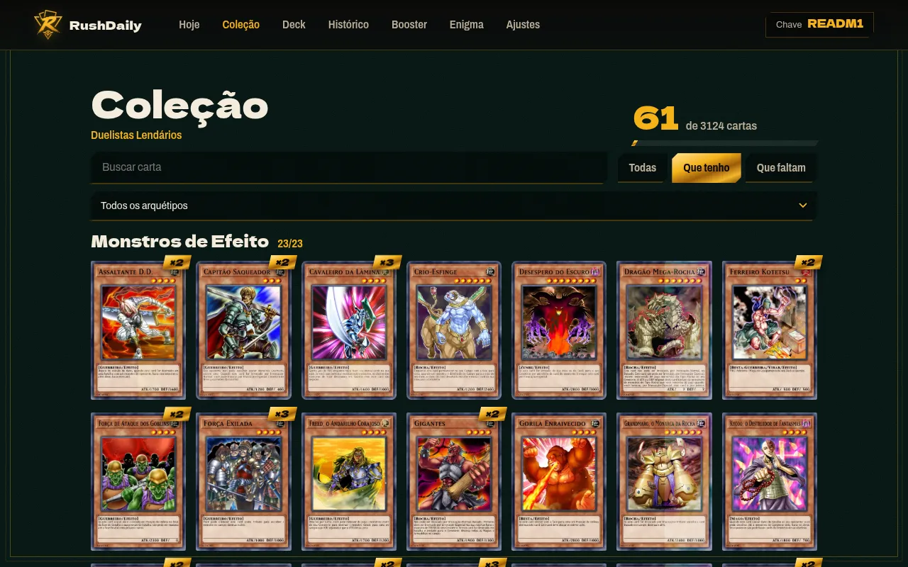
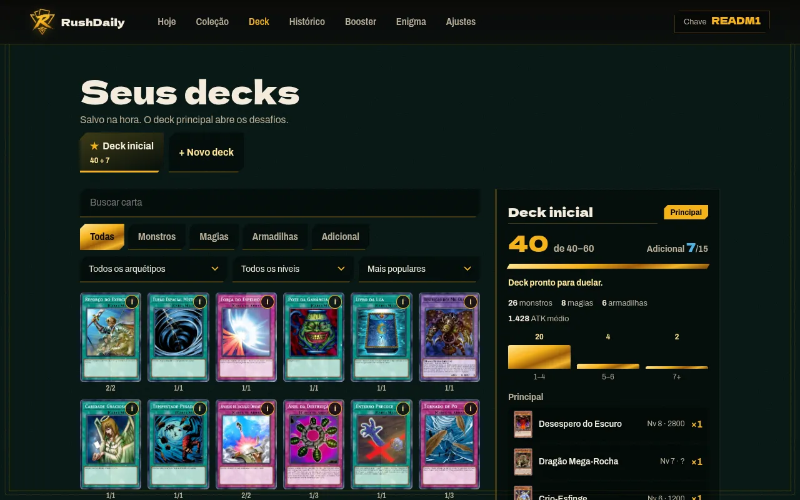
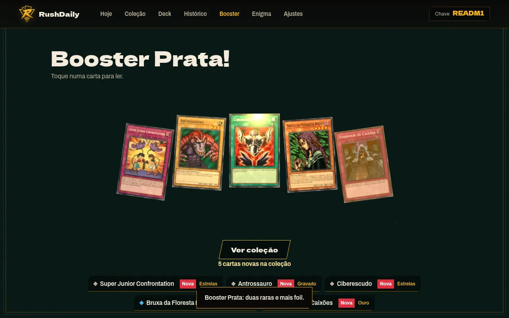
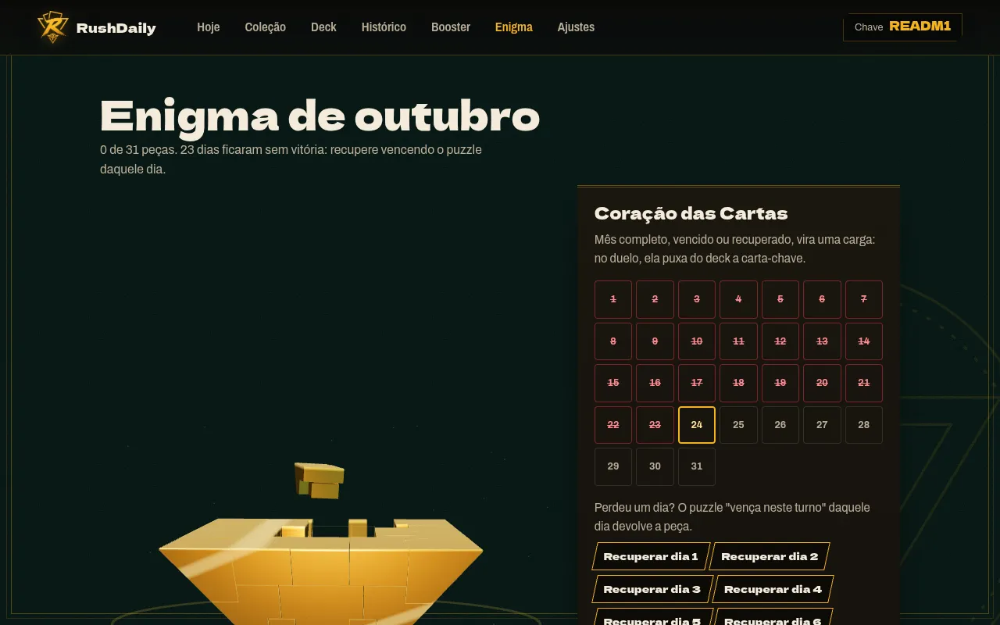
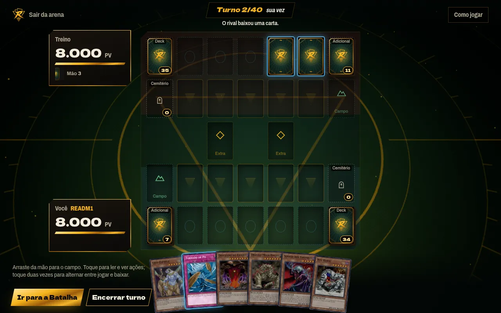
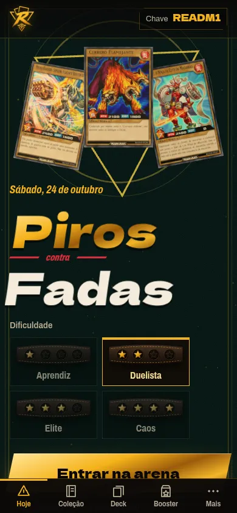
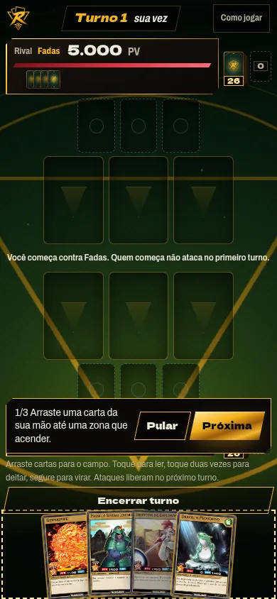

# RushDaily

Jogo web de cartas de **Yu-Gi-Oh!**, feito por fã, sem fins comerciais. Tem um desafio diário igual para todos no **Rush Duel** e uma coleção de cartas do **Yu-Gi-Oh! clássico** que cresce a cada vitória, com o motor oficial do EDOPro rodando no navegador (WebAssembly).

> **Aviso legal (resumo):** projeto de fã, sem fins lucrativos, não afiliado, endossado nem patrocinado pela Konami, Shueisha, Kazuki Takahashi/Studio Dice ou 4Kids. Yu-Gi-Oh! e Rush Duel e seus nomes, artes e marcas pertencem aos seus donos. Nada é vendido e não há anúncios. Se você é detentor de direitos e quer que algo saia do ar, fale com o contato indicado na seção [Aviso legal e licenças](#aviso-legal-e-licencas) e o conteúdo será removido. O texto completo está no fim deste arquivo.

---

## O que é

- **Desafio do dia (Rush Duel):** todo mundo recebe o mesmo desafio no mesmo dia: um deck seu, um deck do rival e uma dificuldade. Vencer libera um booster.
- **Coleção e decks clássicos:** o booster traz cartas do Yu-Gi-Oh! clássico, organizadas por temporada. Hoje está liberada a Temporada 1, com cerca de 3.100 cartas. Você monta decks no formato clássico normal (Principal de 40 a 60 cartas, Adicional de até 15).
- **Motor do EDOPro:** as partidas clássicas rodam no ocgcore, o núcleo do EDOPro compilado para WebAssembly, com os scripts das cartas do ProjectIgnis/CardScripts.
- **PvP assíncrono por link:** você envia o seu deck por um link; quem abre o link joga contra ele, com o deck pilotado pela IA. Não há servidor de partidas.
- **Enigma do Milênio:** um quebra-cabeça 3D mensal. Cada vitória diária dá uma peça; o mês completo libera a carga Coração das Cartas.
- **Cartas desenhadas no navegador:** as cartas clássicas usam a moldura oficial e recebem texto em português.

Não há cadastro. Sua **chave** (por exemplo `READM1`) identifica o perfil no navegador, e o progresso fica salvo no `localStorage` daquele navegador.

## Capturas

Desktop (1280x800):

| Desafio do dia | Arena Rush |
|---|---|
|  |  |

| Coleção | Decks |
|---|---|
|  |  |

| Booster aberto | Enigma do Milênio |
|---|---|
|  |  |

| Arena clássica (treino) |
|---|
|  |

Celular (390x844):

| Desafio do dia | Arena Rush |
|---|---|
|  |  |

## Como jogar

### Desafio do dia

Na tela **Hoje** você vê o confronto do dia (por exemplo, Bestas-Guerreiras contra Feiticeiros), a regra do dia e o deck que recebeu. Escolha a dificuldade (Aprendiz, Duelista, Elite ou Caos, indicadas por estrelas na luva) e entre na arena.

Na arena Rush, arraste as cartas da mão para o campo, toque para ler uma carta, toque duas vezes para deitar e segure para virar. Ataques liberam no turno seguinte. Vencer o duelo libera o booster do dia.

### Booster

Vencer o desafio do dia grava uma recompensa pendente. Na tela **Booster**, toque no pacote 3D para abri-lo e depois em **Revelar todas**, ou toque em cada carta para virá-la. As cartas vão direto para a coleção.

### Coleção e decks

- **Coleção** mostra todas as cartas clássicas da temporada, com as que você tem, as que faltam e as foils. Dá para filtrar por arquétipo e buscar pelo nome.
- **Deck** permite criar vários decks. O deck marcado como principal é o que abre os desafios. Use **Completar automático** para preencher com base em sinergia, ou monte à mão. Um deck só é aceito se seguir as regras da temporada e se você tiver as cartas.
- **Histórico** lista as suas partidas, inclusive os PvP.

### PvP por link

Na tela de decks, copie o link do seu deck (`arena.html?vs=…`) e envie para um amigo. Ele abre o link, escolhe um dos próprios decks válidos e joga contra o seu deck, pilotado pela IA. O resultado entra no Histórico dos dois. Como o deck vai inteiro no link, não há conta nem servidor de partidas.

### Enigma do Milênio

A tela **Enigma** mostra o mês atual em 3D, com um calendário de dias. Cada dia com vitória no desafio diário libera uma peça. Dia sem vitória fica em branco, e o mês não fecha se faltar algum. Com o mês completo, a carga **Coração das Cartas** passa a aparecer nos duelos e puxa a carta-chave do deck.

### Arena clássica (treino)

`arena.html` abre a arena clássica, com o motor do EDOPro: tabuleiro 7x5, gestos de arrastar e zoom, e as mensagens do próprio motor em português. Sem parâmetros, ela é um treino contra o deck da IA. Com o `?vs=` de outro jogador, vira o PvP descrito acima.

## Primeira execução

O repositório guarda só o código, o CSS/HTML, os testes, a documentação e os assets próprios (logo, versos, ícones). Tudo que é dado ou arquivo de terceiros (cartas, artes, scripts, bibliotecas, modelo do Enigma) é baixado ou gerado pelo script de início. Num clone novo:

```bash
npm run setup     # baixa e gera tudo (veja as etapas abaixo)
npm test          # testes do motor e dos dados
npm run serve     # servidor em http://127.0.0.1:4173 (python3 tools/serve.py 4173)
```

Depois, abra **http://127.0.0.1:4173**. Para testar outra chave, use `?player=SUACHAVE` na URL.

**Requisitos:** Node.js 22+, npm, Python 3 com Pillow e numpy, git, curl e ImageMagick 7 (comando `magick`). O setup confere tudo no começo e diz o que instalar (por exemplo `pacman -S python-pillow python-numpy imagemagick` ou `apt install python3-pil python3-numpy imagemagick`). O projeto não tem etapa de build; o navegador carrega os módulos direto.

**Tempo e espaço (TEMPO_MEDIDO):** ESPACO_MEDIDO. A maior parte do tempo vai para os downloads (artes das cartas, que respeitam o limite de 20 pedidos por segundo do YGOPRODeck) e para desenhar as imagens.

**Opções** (`npm run setup -- <opções>`):

| Opção | Efeito |
|---|---|
| `--lista` | Mostra as etapas. |
| `--so <etapa>[,<etapa>]` | Roda só essas etapas (nomes na tabela abaixo). |
| `--temporadas N` | Libera as temporadas 1 a N do clássico (padrão 1). |
| `--sem-render` | Pula o desenho das imagens das cartas (Rush e clássicas). O jogo abre, mas sem as imagens pré-desenhadas. |
| `--force` | Refaz as etapas mesmo já prontas. |

O setup é idempotente: o que já existe é pulado, e se uma etapa falhar basta rodar de novo.

### O que cada etapa baixa

| Etapa | Baixa de onde | Gera | Licença / observação |
|---|---|---|---|
| `three` | npm `three@0.170.0` | `src/vendor/three.module.js` | MIT |
| `ocgcore` | npm `ocgcore-wasm@0.1.6` | `src/vendor/ocgcore/`, com o patch do parser (`tools/setup/patch-ocgcore.mjs`: parser de consulta, COUNTERS, mensagem ilegível e SORT_CARD; falha se alguma âncora não bater, e `tests/ocg-binding.test.mjs` confere) | Wrapper MIT; núcleo EDOPro AGPL-3.0 |
| `yugioh` | npm `yugioh-card` + repositório kooriookami/yugioh-card (só `src/assets/yugioh-card/yugioh` e `rush-duel`) | `src/vendor/yugioh-card/` (bundle com `YugiohCard` e `RushDuelCard`, molduras clássica e Rush reduzidas a 30%; do Rush só a fonte dos números, nome e texto usam as fontes latinas da clássica) | MIT |
| `rush` | yaml-yugi (`rush.json`) e Yugipedia (artes e scans das cartas Rush) | `src/data/cards.mjs` (usa `pool-en.json` e `pt-br.json` do repositório) | Artes da Konami |
| `rush-render` | repositório JLtheking2/rush-hub (molduras, ícones e fontes) e o selo LEGEND do yugioh-card, em `tools/card-render/cache/` | `src/assets/cards/*.webp` | rush-hub sem licença declarada; ver pendências |
| `classico` | YGOPRODeck (dados en/pt, decks de jogadores e artes recortadas), BabelCDB, ProjectIgnis/CardScripts e ProjectIgnis/Puzzles | `src/data/classic/`, `src/vendor/card-scripts/`, `src/assets/classic-art/` | Dados e artes da Konami; scripts AGPL-3.0 |
| `rush-ocg` | BabelCDB (`cards-rush.cdb`) e ProjectIgnis/CardScripts (pasta `rush/` e utilitários da raiz, mesmo commit do clássico), em `tools/rush/cache/` | `src/data/rush/cards.json`, `src/vendor/card-scripts/rush/` (usa `pt-br.json` e `pool-en.json` do repositório para o texto em PT) | Dados da Konami; scripts AGPL-3.0 |
| `rush-art` | yaml-yugi (`rush.json`, do raw.githubusercontent.com, em `tools/rush/cache/`) e Yugipedia (artes limpas ou recorte do scan) | `src/assets/rush-art/<id>.webp` (400 px) e `index.json` | Artes da Konami. Se o Yugipedia não responder, avisa e segue: as cartas saem com o quadro provisório |
| `rush-cartas` | (usa as molduras da etapa `yugioh` e as artes da `rush-art`) | `src/assets/rush-cards/*.webp` (418x609), `rush-cards-sm/` (140 px) e `rush-cards/index.json` | Derivadas de itens acima |
| `classico-render` | (usa as molduras da etapa `yugioh` e as artes da etapa `classico`) | `src/assets/classic-cards/*.webp` (miniaturas pré-desenhadas) | Derivadas de itens acima |
| `vendor-avisos` | (local) | `src/vendor/LICENSE-three.txt`, `yugioh-card/LICENSE`, `ocgcore/COPYING-AGPL-3.0` e `src/vendor/CHECKSUMS.txt` (SHA-256) | Roda sempre; barata |
| `enigma` | API pública do Printables (modelo 517699, 39 arquivos STL, sem login) | `src/assets/puzzle/` | CC BY-NC-SA, crédito na tela do Enigma |

Os downloads grandes ficam em `tools/*/cache/`, que o git ignora. O YGOPRODeck pede que as imagens sejam baixadas e hospedadas por você; é isso que o setup faz, a no máximo cerca de 16 pedidos por segundo. Os repositórios do GitHub são baixados por commit fixo (rush-hub, yugioh-card e os CardScripts, este em `tools/classic/CARDSCRIPTS_SHA`), e o `curl` do importador só aceita HTTPS e arquivos de até 100 MB, então o resultado é reprodutível.

## Como publicar

O jogo é estático: um container **nginx** serve a pasta. O `Dockerfile` copia as páginas HTML e `src/` (a pasta `tools/` fica de fora) e o nginx escuta na porta 8080. O único backend é o **servidor de sincronização** (`server/`, Node 24 + SQLite, serviço `rushdaily-sync` no compose), que o nginx encaminha em `/api/` (veja "Sincronização entre aparelhos").

**A imagem é montada depois do `npm run setup`:** como `src/` só tem as imagens, os dados e as bibliotecas depois do setup, rode o setup na máquina de build antes do `docker compose build`. Decisão: o `Dockerfile` **não** ganhou o estágio de setup (o setup leva ~25 min, baixa centenas de MB da internet e precisa de Python, Pillow, ImageMagick e do binário do skia-canvas; não dá para verificar de forma rápida e repetível). Proposta para um build 100% a partir do repositório: um estágio `FROM node:22` com python3, Pillow, numpy, git, curl e imagemagick que copia o repositório, roda `npm run setup` e entrega `src/` ao estágio do nginx (`COPY --from=setup /app/src ...`). Fica simples, mas o build passa a depender da internet e leva o tempo do setup; use `--mount=type=cache` em `tools/classic/cache` e `tools/card-render/cache` para não baixar tudo de novo.

```bash
# Build da imagem
docker compose build

# Subir o container
docker compose up -d

# Testes dentro do build (etapa "test" do Dockerfile, não roda no build normal)
docker build --target test .
```

O `docker-compose.yml` **não publica porta** no host de propósito. Para teste local, descomente o bloco `ports` com `127.0.0.1:4173:8080`. Nunca use `0.0.0.0`.

### Deploy pelo GitHub Actions (recomendado)

O workflow [`.github/workflows/deploy.yml`](.github/workflows/deploy.yml) ("Pacote de deploy") faz o trabalho pesado fora do homelab: instala as dependências, roda `npm run setup` (com cache entre execuções), roda `npm test` e publica duas imagens no **GitHub Container Registry**:

| Imagem | Conteúdo |
|---|---|
| `ghcr.io/clevim/rushdaily` | O site (nginx com as páginas, dados, cartas e bibliotecas geradas pelo setup) |
| `ghcr.io/clevim/rushdaily-sync` | O servidor de sincronização (Node 24 + SQLite) |

Cada imagem sai com as etiquetas `latest`, o commit curto (`sha-xxxxxxx`) e, quando o disparo é uma tag `v1.2.3`, a versão (`1.2.3`).

1. **Disparar:** em *Actions › Pacote de deploy › Run workflow* (escolha as temporadas, de 1 a 5) ou criando e enviando uma tag `v*`. A primeira execução é longa (baixa tudo e desenha ~3.600 cartas); as seguintes reaproveitam o cache.
2. **Deixar os pacotes privados (obrigatório):** as imagens levam artes e cartas de terceiros (Konami). Depois da primeira execução, em *Packages › rushdaily* (e *rushdaily-sync*) › *Package settings › Change visibility › Private*.
3. **No homelab:**

   ```bash
   # Uma vez: login no GHCR com um token pessoal (classic) com permissão read:packages
   echo "$TOKEN" | docker login ghcr.io -u clevim --password-stdin

   # Uma vez: .env ao lado do docker-compose.yml (não vai para o git)
   echo "ADMIN_TOKEN=$(openssl rand -hex 32)" > .env

   # A cada atualização
   docker compose pull
   docker compose up -d
   ```

   O `docker-compose.yml` aponta para `ghcr.io/clevim/rushdaily:latest` e `ghcr.io/clevim/rushdaily-sync:latest`; para uma versão fixa, troque `latest` pela etiqueta desejada. O homelab só precisa do `docker-compose.yml`, do `.env` e da configuração do nginx já embutida na imagem — não precisa do Node, do Python nem do setup.

Se o Printables (modelo do Enigma) ou o Yugipedia (cartas Rush) bloquearem os servidores do GitHub, o setup para com uma mensagem clara; rode o workflow de novo (ele retoma pelo cache) ou monte a imagem localmente com `docker compose up -d --build` depois do `npm run setup`.

### Cloudflare Tunnel (recomendado)

1. **Rede:** coloque o `cloudflared` na mesma rede Docker do container e aponte o ingress para `http://rushdaily:8080`. O serviço do jogo não publica porta no host, então a única entrada é a Cloudflare.
2. **HTTPS e HSTS na Cloudflare:** ligue "Always Use HTTPS" e o HSTS em SSL/TLS › Edge Certificates (comece com `max-age` curto e depois suba para 6 meses; sem `preload` por enquanto). O nginx serve só HTTP interno.
3. **Cabeçalhos de segurança** já vêm do nginx (`nginx-security.conf`, incluído em cada `location`): CSP testada com o motor em WebAssembly e o booster, `nosniff`, `Referrer-Policy`, `Permissions-Policy`, `frame-ancestors 'none'`, `server_tokens off` e só GET/HEAD. Não use as Transform Rules da Cloudflare para isso.
4. **Cache na Cloudflare** (veja a tabela "Cache e Cloudflare" abaixo): por padrão ela não guarda `.json`, `.mjs`, `.lua`, `.wasm` nem HTML. Crie as Cache Rules da tabela, ligue Brotli (Speed › Optimization › Content Optimization) e desligue Rocket Loader e Auto Minify, que quebram os módulos ES. Depois de regerar artes ou dados, faça **Purge**. Nunca "Cache Everything" em `/healthz`.
5. **IP real** (só se for registrar ou limitar por IP no nginx): `set_real_ip_from <sub-rede Docker do cloudflared>; real_ip_header CF-Connecting-IP;`. Confie só na rede interna, nunca em `0.0.0.0/0`.
6. **WAF e limites:** regras gerenciadas ligadas e rate limiting folgado (ex.: 300 pedidos/min por IP; a primeira visita baixa muitos arquivos). Bloqueie `/healthz` para fora.
7. **Container:** o compose já roda `nginx-unprivileged` fixado por digest, sem root, `read_only` com `tmpfs`, `cap_drop: ALL` e `no-new-privileges`.
8. **Antes de divulgar a URL:** preencha o link do código-fonte (exigido pela AGPL) e o contato do aviso legal. Hospedar as fontes no próprio site permite tirar os domínios do Google da CSP.
9. **Cloudflare Access** é opcional: o jogo não tem área privada; só vale para um beta fechado.

### Sincronização entre aparelhos

O progresso (coleção, decks, histórico, PvP, boosters, Enigma, Coração das Cartas e a dificuldade) é o mesmo em todos os aparelhos ligados à mesma chave. Partidas em andamento, "reduzir animações" e caches continuam de cada aparelho. Desenho completo, regras de junção e riscos: `docs/sync/README.md`.

- **Como o jogador liga um aparelho:** no aparelho que já joga, *Ajustes › Sincronizar aparelhos › Ligar outro aparelho* mostra um QR e um link `index.html?player=CHAVE#sync=SEGREDO`. Abra o link (ou leia o QR) no aparelho novo: ele passa a usar a mesma chave e recebe o progresso. QR e link somem quando a seção fecha (ou em 2 min); não compartilhe, eles dão acesso ao progresso.
- **Automático:** no primeiro carregamento com internet, o aparelho gera um segredo de 256 bits e reivindica a chave; depois sincroniza ao abrir cada página e 2 s depois de cada mudança. Sem internet o jogo segue normal e sincroniza na próxima vez. Se a chave já foi reivindicada por outro aparelho, *Ajustes* avisa e oferece ligar pelo link ou **gerar uma chave nova** levando o progresso local.
- **Ajustes:** sincronizar agora, trocar o segredo (os outros aparelhos precisam do link novo), desligar neste aparelho e desligar apagando a cópia do servidor.
- **Desenvolvimento:** `npm run sync` (servidor em `127.0.0.1:8787`, banco em `server/data/sync.db`) e `npm run serve` (o `tools/serve.py` encaminha `/api/*` para ele; outro endereço em `SYNC_URL`). Sem o `npm run sync` o jogo funciona, só não sincroniza.
- **Publicação:** o `docker compose up -d --build` já sobe o `rushdaily-sync` (sem porta no host, rede interna `sync` só com o nginx, `read_only`, sem root, volume `sync-data`). Para as estatísticas de acesso, crie `.env` (`ADMIN_TOKEN=…`) ao lado do compose. Backup diário (`VACUUM INTO`, 7 arquivos) em `/data/backup`; recomendado montar essa pasta em outro disco (exemplo comentado no compose; a pasta precisa ser do usuário 1000). Restaurar: parar o serviço, copiar o backup para `/data/sync.db`, apagar `sync.db-wal` e `sync.db-shm`, subir.
- **Cloudflare:** crie uma Cache Rule **Bypass** para `/api/*` (a resposta já vem com `no-store`, mas sem cache nenhum na borda é mais seguro); a regra de rate limiting do hostname também cobre `/api/*` (o servidor ainda limita por IP: 60/min, por chave: 30/min e 5 chaves novas por hora por IP). O IP real vem do `CF-Connecting-IP`, aceito pelo nginx só de redes privadas do Docker (troque pelas sub-redes exatas da rede do cloudflared para fechar mais).
- **Privacidade (LGPD):** com a sincronização ligada, o servidor guarda a chave, o progresso e as datas de acesso (primeiro e último acesso, contagem e dias ativos) — **sem IP, User-Agent, nome ou e-mail**. *Ajustes › Desligar e apagar do servidor* (`DELETE /api/sync/:key`) remove o progresso e todos os registros de acesso dessa chave.
- **Acompanhamento de acessos (admin):** com `ADMIN_TOKEN` (32+ caracteres, no `.env` ao lado do compose, fora do git) o `rushdaily-sync` abre um segundo listener (8788) só de leitura, publicado **apenas** em `127.0.0.1:4192` do host. Ele não passa pelo nginx nem pelo cloudflared (nunca aponte para ele). O painel `npm run admin` (seção *Jogadores*) consulta essa porta por túnel SSH; veja `tools/admin/LEIA-ME.md`.
- **Admin:** liberar uma chave tomada por engano: `docker compose exec rushdaily-sync node -e "new (require('node:sqlite').DatabaseSync)('/data/sync.db').prepare('DELETE FROM saves WHERE key = ?').run('ABC123')"`.

### Cache e Cloudflare

O `nginx.conf` já manda o `Cache-Control` certo por tipo (sem build não há arquivos com hash, então código e dados usam prazo curto com `stale-while-revalidate`, e as imagens de nome estável usam 7 dias):

| O quê | `Cache-Control` do nginx | Observação |
|---|---|---|
| `.html`, `.js`, `.mjs`, `.css`, `.json` | `public, max-age=300, stale-while-revalidate=86400` | Uma atualização aparece em até 5 min (ou no recarregamento seguinte). Medido: 2ª visita sem requisição à origem em 5 min. |
| `.lua` (scripts das cartas), `.wasm` (motor) | `public, max-age=604800, stale-while-revalidate=86400` | `.lua` sai como `text/plain` (comprime ~6x); `.wasm` como `application/wasm`. |
| `.webp`, `.png`, `.svg`, `.woff2`, `.bin` | `public, max-age=604800, stale-while-revalidate=86400` | Nome estável (id da carta). Para forçar uma arte nova: purge ou renomear. |
| `ocgcore.sync-*.js` (hash no nome) | `public, max-age=31536000, immutable` | |

**Cache Rules da Cloudflare** (dashboard › Caching › Cache Rules; "Eligible for cache" + "Use cache-control header if present" no Edge TTL e "Respect origin" no Browser TTL, assim valem os prazos acima):
1. *Dados e código:* expressão `(ends_with(http.request.uri.path, ".json")) or (ends_with(http.request.uri.path, ".mjs")) or (ends_with(http.request.uri.path, ".js")) or (ends_with(http.request.uri.path, ".css")) or (ends_with(http.request.uri.path, ".html")) or (http.request.uri.path eq "/")`.
2. *Motor e scripts:* `(ends_with(http.request.uri.path, ".lua")) or (ends_with(http.request.uri.path, ".wasm"))`.
3. *Imagens* (`.webp`, `.png`, `.svg`, `.woff2`, `.bin`) já são cacheadas por padrão; a regra 2 pode incluí-las se quiser TTL explícito.
4. *Fora do cache:* `/healthz` e `/api/*` (Bypass cache).
5. Brotli ligado: a origem entrega gzip (`gzip_vary on`, `gzip_proxied any`) e a borda recomprime em Brotli (−25 a −40% em JS e JSON).

Efeito esperado por duelo clássico: ~85 requisições de `.lua` (≈ 600 KB sem compressão antes) passam a sair da borda e, na origem, comprimidas (≈ 105 KB).

## Estrutura do projeto

```text
index.html            Desafio do dia (Rush): leque 3D, confronto, dificuldade, deck do dia
duel.html             Arena Rush (motor próprio)
screens.html          Coleção, Decks, Booster 3D, Enigma do Milênio, Histórico e Ajustes
arena.html            Arena clássica (motor do EDOPro): PvP por link, treino, puzzles e replay
src/
  engine/             Regras e IA, sem DOM nem Three.js
    game-engine.mjs   Rush: posições, viradas, magias/armadilhas, Coração das Cartas
    rules.mjs · effects.mjs · ai.mjs · daily-generator.mjs
    ocg.mjs           Ponte com o ocgcore (WebAssembly): formatos, duelo, limite de turnos
    ocg-ai.mjs        IA do rival no clássico
    classic-deck.mjs  Decks gerados por sinergia de decks reais
    rush-deck.mjs     Decks Rush (motor do EDOPro) gerados por tema, com validação das regras de deck
  ui/                 Interface: home.js, duel.js, screens.js, arena.js, common.js (nav, chave, Enigma),
                      scene.js (Three.js), classic-store.js (coleção/decks/link de desafio),
                      classic-render.js (desenho das cartas sob demanda), classic-card*.js,
                      rush-render.js e rush-card-data.js (cartas Rush do motor do EDOPro)
  styles/             rush.css (tokens e componentes) + home, duel, screens, arena
  data/               Dados gerados pelo setup (exceto classic/strings-pt.mjs, editado à mão)
  assets/             Logo, versos e ícones do projeto; cartas, artes e Enigma vêm do setup
  vendor/             Three.js, ocgcore-wasm, yugioh-card e scripts das cartas (vêm do setup)
tools/                setup/ (npm run setup), classic/ (pool, decks, puzzles, render), card-render/ (Rush),
                      rush/ (Rush no motor do EDOPro: importador e simulador),
                      puzzle/ (modelo do Enigma), serve.py (servidor de desenvolvimento)
tests/                node --test tests/*.test.mjs
```

Regras de dependência entre as pastas:

- `src/engine` não importa DOM, CSS nem Three.js. Os motores rodam no Node (testes e ferramentas) e no navegador.
- `src/data` só tem dados e normalizadores, nunca regra de interface.
- `src/ui` manda comandos para o motor e desenha o estado que ele devolve; não reimplementa regra de jogo.
- `src/styles` não tem lógica de jogo.
- `tests` exercita os motores sem navegador sempre que possível.
- Contratos compartilhados: `classic-store.js` (coleção, decks, validação e link de desafio), `classic-render.js` (`classicImg`, `paintCards`, `classicCardUrl`) e `rush-render.js` (`rushImg`, `paintRushCards`, `rushCardUrl`, `warmRushCards`, `RUSH_BACK`). Mudar uma assinatura exige atualizar todos os usuários.

## Regerar dados e cartas

O `npm run setup` chama os comandos abaixo. Para regerar só uma parte, rode a partir da raiz do projeto (os downloads vão para `tools/*/cache/`):

**Pool clássico** (`tools/classic/import_cards.py`, rode com `python3 -I`):

- `fetch`: baixa os dados do YGOPRODeck (en e pt), do BabelCDB e os scripts do CardScripts (precisa de internet e de `git`).
- `build --ate N`: gera os dados e copia os scripts das temporadas 1 a N. Use `--ate 1` para a Temporada 1.
- `decks`: baixa decks de jogadores para medir a sinergia usada no deck inicial e no `Completar automático`.
- `puzzles`: baixa os puzzles do EDOPro e valida no motor.
- `art`: baixa as artes recortadas das temporadas liberadas e dos puzzles.
- `node tools/classic/render/render.mjs [--force] [id ...]`: desenha as cartas clássicas em PT-BR (precisa do `npm ci` em `tools/classic/render`, que o setup faz).
- `node tools/classic/simulate.mjs 300 N`: simula duelos com decks sorteados e conta erros de script.

**Rush Duel no motor do EDOPro** (`tools/rush/import_rush.py`, rode com `python3 -I`; etapa `rush-ocg` do setup):

- `fetch`: baixa o `cards-rush.cdb` do BabelCDB e os scripts Rush do CardScripts (clone sparse no commit de `tools/classic/CARDSCRIPTS_SHA`).
- `build`: gera `src/data/rush/cards.json` (todas as cartas jogáveis, no mesmo formato do pool clássico, mais `legend` e `maximum`) e copia os scripts para `src/vendor/card-scripts/rush/`. Nome e texto em PT vêm do `pt-br.json` do desafio diário; o resto fica em inglês (`pt: false`).
- `art [--force] [id ...]`: baixa as artes das cartas Rush para `src/assets/rush-art/<id>.webp` (400 px) e grava `index.json` com os ids que têm arte. Casa cada carta do `cards.json` com o yaml-yugi (`rush.json`, baixado do raw.githubusercontent.com para `tools/rush/cache/`) pelo nome em inglês; os nomes que o BabelCDB traduziu diferente são casados pelos atributos do monstro (ATK, DEF, nível, atributo e tipo, quando únicos) e as Magias/Armadilhas pelo nome mais parecido. A arte vem do Yugipedia (CDN `ms.yugipedia.com`, caminho pelo md5 do nome do arquivo), na ordem: ilustração limpa do yaml-yugi, arte limpa achada pela API (mesmos padrões do `import_pool.py`) e recorte da janela de arte do scan; cartas fora do yaml-yugi tentam a imagem da página "<nome> (Rush Duel)". Só HTTPS, ~3 pedidos por segundo, pula as que já existem e relata quantas faltam e quantas ficaram sem fonte. As fontes achadas ficam em `tools/rush/cache/art-sources.json` (`--force` refaz tudo).
- `node tools/rush/render.mjs [--force] [id ...]`: monta as cartas pré-desenhadas (`src/assets/rush-cards/`, 418x609, e `rush-cards-sm/`, 140 px) com o mesmo desenho do navegador (`src/ui/rush-card-data.js`). Refaz sozinho as cartas cuja arte chegou depois; mudou o desenho, use `--force` (e suba `CACHE_VERSION` em `src/ui/rush-render.js`).
- `node tools/rush/simulate.mjs 600 [todos|ia|aleatorio]`: duelos da IA com decks gerados e de um bot aleatório com decks sorteados; conta erros de script e travamentos.

**Desenho das cartas Rush do motor** (`src/ui/rush-render.js`): usa a pré-desenhada quando existe (listada em `rush-cards/index.json`; as miniaturas pequenas usam `rush-cards-sm`); senão desenha no navegador com o `RushDuelCard` do yugioh-card, com a arte de `rush-art/` ou, sem ela, um quadro no tom do atributo com o selo dourado do verso. Nome e texto em PT quando a carta tem tradução (`pt: true`), senão em inglês; tipos, rótulos de Magia/Armadilha e a linha de tipo sempre em PT; selo LEGEND nas Lendas e ATK MAX na peça central do Máximo. Cache no navegador como o clássico (`CACHE_VERSION`). As frentes antigas do desafio diário (`src/assets/cards/`, ids da Konami, molduras do rush-hub) não são usadas aqui: as 3.232 cartas saem no mesmo desenho, sem depender das molduras e fontes sem licença do rush-hub. Pelo painel admin: **Artes Rush** e depois **Montar cartas Rush**.

O formato fica em `FORMATS.rush` (`src/engine/ocg.mjs`): regras do Rush pelo próprio ocgcore (`MODE_RUSH`: campo de 3 colunas, compra até 5, Invocações ilimitadas), 8000 PV, mão inicial de 4, deck de 40 e scripts da pasta `rush/`. As zonas válidas do campo estão em `RUSH_ZONES`.

**Cartas Rush** (`tools/card-render/`):

- `python3 tools/card-render/import_pool.py fetch` e depois `build`: escolhe as cartas e gera `src/data/cards.mjs`.
- `python3 tools/card-render/render.py [--force] [id ...]`: desenha as frentes em PT-BR (precisa de Pillow; baixa sozinho as molduras e fontes do rush-hub para `tools/card-render/cache/`).
- `python3 tools/card-render/back.py src/assets [feltro|rubi|safira]`: gera os versos (já estão no repositório).

**Outros:**

- `node tools/setup/patch-ocgcore.mjs <index.js>`: aplica o patch do parser no `index.js` do ocgcore-wasm.
- `python3 tools/puzzle/build_puzzle.py <pasta-dos-stl> src/assets/puzzle`: converte o modelo do Enigma para o formato do jogo.
- `python3 tools/cutout.py entrada.png saida.png [--furos]`: recorta o fundo preto dos logos.

## Arquivos que não vão para o repositório

O `.gitignore` deixa de fora tudo que o setup popula:

- **Bibliotecas de terceiros** (`src/vendor/three.module.js`, `ocgcore/`, `yugioh-card/`, `card-scripts/`).
- **Dados gerados** (`src/data/cards.mjs`, `src/data/rush/`, `src/data/classic/*`, menos `strings-pt.mjs`, que é editado à mão; `tools/classic/puzzle-solutions.json`).
- **Imagens de cartas e artes** (`src/assets/cards/`, `classic-art/`, `classic-cards/`, `rush-art/`, `rush-cards/`, `rush-cards-sm/`): artes da Konami ou derivadas de molduras de terceiros, sem licença para publicação no repositório.
- **Modelo do Enigma** (`src/assets/puzzle/`): CC BY-NC-SA, baixado do Printables.
- **Caches e dependências** (`tools/**/cache/`, `node_modules`): downloads, clones e bases de dados, regeráveis.
- **Lixo de sistema** (`.DS_Store`, `*.log`, `.hallmark/`, `__pycache__/`).

Ficam no repositório: código, HTML, CSS, testes, documentação, traduções (`pt-br.json`, `strings-pt.mjs`), a seleção de cartas Rush (`pool-en.json`), o logo, os versos `.svg` e as capturas de `docs/imagens/`. A pasta antiga `tools/card-render/vendor/` não é mais usada e pode ser apagada.

## Créditos

- **Motor de duelo clássico:** núcleo do EDOPro (ygopro-core), através do wrapper `ocgcore-wasm` de Simone Miraglia (MIT).
- **Scripts das cartas clássicas e Rush:** ProjectIgnis/CardScripts.
- **Dados e artes:** YGOPRODeck (API e imagens), BabelCDB.
- **Molduras das cartas clássicas e das Rush do motor, e selo LEGEND:** yugioh-card, de kooriookami (MIT).
- **Molduras, ícones e fontes das cartas Rush:** rush-hub, de JLtheking2, com molduras de AlixSep.
- **Enigma do Milênio:** "Millennium Puzzle Remix", de TechSpiderbot (Printables), a partir do enigma de Sho Tozuka. Crédito também exibido na tela do Enigma.
- **Three.js** (MIT) para as cenas 3D.
- **Fontes:** Archivo e Dela Gothic One (Google Fonts, OFL).

---

## Aviso legal e licenças

### Aviso

- Este é um **projeto de fã, sem fins lucrativos**. Não é afiliado, endossado nem patrocinado pela **Konami**, **Shueisha**, **Kazuki Takahashi / Studio Dice** ou **4Kids**.
- **Yu-Gi-Oh!**, **Rush Duel**, os nomes de cartas, as artes, os textos oficiais e as marcas pertencem aos seus respectivos donos. Nenhum desses direitos é reivindicado por este projeto.
- Artes e dados de cartas vêm do **YGOPRODeck** e do **Yugipedia**; os textos em português vêm das traduções oficiais quando existem.
- **Nada é vendido**, não há anúncios, contas pagas nem monetização de nenhum tipo.
- **Privacidade:** com a sincronização ligada, o servidor guarda a sua chave, o seu progresso e as datas de acesso — sem IP, nome ou e-mail. "Desligar e apagar do servidor" remove tudo.
- **Remoção:** se você é detentor de direitos e quer que algum conteúdo saia do ar, escreva para **rushdaily@clevs.dev.br** ou abra uma *issue* em <https://github.com/clevim/RushDaily/issues>. O conteúdo será removido assim que possível.
- Isto **não é aconselhamento jurídico**: é um levantamento feito a partir dos arquivos do projeto.

### Licença deste projeto

O código do RushDaily (HTML, CSS, JavaScript, ferramentas e testes deste repositório) é distribuído sob a **GNU Affero General Public License v3.0 ou posterior** — veja o arquivo [`LICENSE`](LICENSE).
A licença cobre **só o código e os assets próprios** (logos, versos, ícones e originais em `design/`). **Não** cobre as cartas, artes, textos e marcas de terceiros, que pertencem aos seus donos (ver acima e a tabela abaixo).

**Código-fonte (AGPL-3.0):** o núcleo do EDOPro e os scripts das cartas são AGPL-3.0, e o jogo inteiro segue a mesma licença. O código-fonte completo — inclusive o patch local do `ocgcore-wasm` (`tools/setup/patch-ocgcore.mjs`) — está em **<https://github.com/clevim/RushDaily>**, e o jogo mostra o link em **Ajustes › Créditos e avisos**. Quem publicar uma versão modificada precisa oferecer o código-fonte dela aos usuários.

### Licenças de terceiros

Os arquivos de terceiros **não estão no repositório**: o `npm run setup` baixa cada um da fonte original e copia o texto da licença junto (`src/vendor/*/LICENSE*`, `COPYING*`), com somas de verificação em `src/vendor/CHECKSUMS.txt`.

| Componente | Onde fica (após o setup) | Licença |
|---|---|---|
| Núcleo do EDOPro (ygopro-core), compilado em WebAssembly | `src/vendor/ocgcore/` | AGPL-3.0 (`COPYING-AGPL-3.0`) |
| `ocgcore-wasm` 0.1.6 (wrapper), com patch local | `src/vendor/ocgcore/` | MIT (`LICENSE.md`, com a descrição do patch) |
| Scripts Lua das cartas (ProjectIgnis/CardScripts, commit fixo em `tools/classic/CARDSCRIPTS_SHA`; clássicas em `official/`, Rush em `rush/`) | `src/vendor/card-scripts/` | AGPL-3.0 (`COPYING`) |
| yugioh-card (kooriookami), desenho das cartas clássicas e Rush | `src/vendor/yugioh-card/` | MIT (`LICENSE`) |
| Three.js r170 | `src/vendor/three.module.js` | MIT (`LICENSE-three.txt`) |
| qrcode-generator 2.0.4 (QR de ligar aparelho) | `src/vendor/qrcode/` | MIT (`LICENSE`) |
| Modelo 3D "Millennium Puzzle Remix" (TechSpiderbot, Printables 517699) | `src/assets/puzzle/` | CC BY-NC-SA 4.0 — crédito na tela do Enigma, uso não comercial; as peças convertidas seguem a mesma licença |
| Molduras, ícones e fontes do rush-hub (cartas Rush) | `tools/card-render/cache/` (só para gerar as imagens) | Sem licença declarada — usados localmente para desenhar as cartas |
| Fontes Matrix, Stone Serif, Eurostile e Amiri (cartas Rush) | idem | Comerciais/não declaradas — **trocar por fontes livres está nas pendências** |
| Archivo e Dela Gothic One | Google Fonts | OFL-1.1 |
| Artes e imagens das cartas (Rush e clássicas) e textos oficiais | `src/assets/cards*/`, `classic-*/`, `rush-*/`, `src/data/` | © Konami e detentores — usados como conteúdo de fã, sem licença; remoção a pedido |
| Capturas em `docs/imagens/` | este repositório | mostram artes e molduras de terceiros: mesmas condições da linha acima |

### Pendências legais conhecidas

1. Trocar as fontes comerciais das cartas Rush por fontes livres e revisar as molduras do rush-hub.
2. Confirmar com o autor do modelo do Enigma o uso das peças convertidas (CC BY-NC-SA).
3. Hospedar as fontes do Google no próprio site (privacidade).
